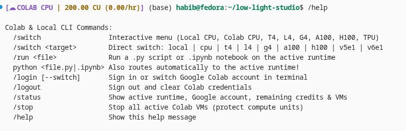
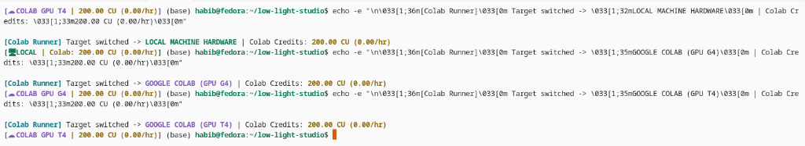

# Colab Runner (`colab-runner`)

A lightweight, CLI-first workflow (plus optional VS Code extension) to seamlessly run `.py` scripts and `.ipynb` notebooks on your **Local Machine** or **Google Colab (CPU, T4, L4, G4, A100, H100, TPU)** right from your terminal—complete with slash commands (`/switch`, `/run`, `/login`, `/status`, `/stop`) and a persistent terminal prompt showing your active runtime and remaining Colab credits.



---

## Features

- **Slash commands in any Bash terminal:** Switch between Local CPU, Local GPU, Colab CPU, and Colab GPUs/TPUs with `/switch`.
- **Tier-aware `/switch` & Free-Tier session hours:**
  - Automatically detects your Colab account tier via `/tun/m/ccu-info`.
  - **Free-Tier users** see their **remaining session hours** (e.g. `Free: 3h 48m left` on T4 GPU's 4h limit / `12h` on CPU) instead of `0.00 CU`.
  - In `/switch`, runtimes available to your account (`Local CPU`, `Local GPU`, `Colab CPU`, and `T4` on Free Tier) appear in bold dark colors, while Pro-only GPUs/TPUs (`L4`, `G4`, `A100`, `H100`, `TPU`) appear greyed out.
- **Automatic next-best GPU fallback:** If your selected Colab GPU (e.g. `A100`) is temporarily at capacity on Google Colab (`503 Service Unavailable`), `colab-runner` immediately informs you in the terminal and automatically connects to the **next best available eligible GPU** (`H100 → A100 → L4 → G4 → T4`), updating your prompt badge to the connected GPU.
- **Transparent `python` routing:** Once you `/switch t4` (or `/switch cpu`, `/switch local-cpu`, `/switch local-gpu`), running either `/run script.py` or `python script.py` / `python notebook.ipynb` automatically executes on the active hardware.
- **Persistent prompt indicator:** Your active hardware and remaining Colab quota/credits stay visible in your terminal prompt across `clear`, `Ctrl+L`, and VS Code's **Clear Terminal** button.
- **Terminal-native Google Colab auth:** Connect, switch accounts, or sign out cleanly in the terminal via `/login`, `/login --switch`, and `/logout`.
- **Compute-unit & close safety:**
  - Switching runtimes automatically stops previous `vscode-*` Colab VMs, and `/stop` tears down all active Colab sessions.
  - Typing `exit` in a terminal with an active Colab VM warns you and prompts to stop VMs first.
  - Closing a terminal in VS Code triggers a modal warning popup; closing VS Code or force-closing a terminal (`SIGHUP`) automatically terminates all active Colab VMs in the background and fires a desktop notification so credits don't burn.



---

## Installation (Single Command)

Run this **one command** in your VS Code terminal or any Linux/macOS Bash terminal—it automatically installs the prerequisite (`google-colab-cli >= 0.8.0`), all slash commands (`/switch`, `/run`, `/login`, `/status`, `/stop`), and the VS Code extension (when `code` is available):

```bash
curl -fsSL https://raw.githubusercontent.com/habibsnippets/colab-runner/main/install.sh | bash
```

*(Pass `--no-vscode` if you only want the terminal CLI without installing the VS Code extension: `curl -fsSL https://raw.githubusercontent.com/habibsnippets/colab-runner/main/install.sh | bash -s -- --no-vscode`)*

### Alternative: Install from Cloned Repository

```bash
git clone https://github.com/habibsnippets/colab-runner.git
cd colab-runner
./install.sh
```

Then reload your shell (or open a new terminal):

```bash
source ~/.bashrc
```

---

## Quick Start (30 Seconds)

1. **Link your Google Colab account in the terminal:**
   ```bash
   /login
   ```
   Open the printed Google authorization URL, approve access, and paste the authorization code back into the terminal.

2. **Choose your runtime:**
   ```bash
   /switch           # Interactive menu
   /switch t4        # Or switch directly to Colab T4 GPU
   /switch cpu       # Switch to Colab CPU
   /switch local-gpu # Switch to Local Machine GPU (if CUDA/NVIDIA GPU is active)
   /switch local-cpu # Switch to Local Machine CPU
   ```

3. **Run any `.py` script or `.ipynb` notebook:**
   ```bash
   /run examples/benchmark_hardware.py
   # or simply:
   python examples/benchmark_hardware.py
   python examples/test_notebook.ipynb
   ```

4. **Check credits or stop active VMs when finished:**
   ```bash
   /status
   /stop
   ```

---

## Command Reference

| Command | Description |
| :--- | :--- |
| `/switch` | Open interactive menu (`Local CPU`, `Local GPU`, `Colab CPU`, `T4`, `L4`, `G4`, `A100`, `H100`, `TPU v5e1`/`v6e1`, `stop`) |
| `/switch <target>` | Direct switch (`local-cpu`, `local-gpu`, `cpu`, `t4`, `l4`, `g4`, `a100`, `h100`, `v5e1`, `v6e1`, `stop`; optional `--high-mem`) |
| `/run <file>` | Run a `.py` script or `.ipynb` notebook on the active runtime |
| `python <file.py\|.ipynb>` | Automatically routes single `.py` / `.ipynb` file execution to the active runtime |
| `/login [--switch]` | Sign in to Google Colab or switch accounts directly in the terminal |
| `/logout` | Sign out and clear Colab CLI credentials (keyring & legacy token file) |
| `/status` | Display active runtime, Google account, remaining credits, burn rate & active VMs |
| `/stop` | Stop all active Colab VMs to preserve compute units |
| `/help` | Show the slash command reference |

> **Note:** Underlying standalone binaries (`colab-switch`, `colab-runner`, `colab-login`, `colab-logout`, `colab-status`) are also installed in `~/.local/bin/`.

---

## Hardware Verification & Benchmark Results (`examples/benchmark_hardware.py`)

Run `python examples/benchmark_hardware.py` across runtimes to verify active hardware and measure latency:

| Runtime | Status & Detected Hardware | `4096×4096` FP32 MatMul (Mean) | Throughput | 3-Layer MLP (`B=2048`) | Elementwise (`16.7M`) | Speedup vs Local CPU |
| :--- | :--- | :---: | :---: | :---: | :---: | :---: |
| **Local Machine CPU** (`local-cpu`) | Verified — `Intel Core i5-1135G7 @ 2.40GHz` (8 cores, `15.4 GB` RAM) | `356.87 ms` | `385.1 GFLOPS` | `494.93 ms` | `79.19 ms` | `1.0×` (Baseline) |
| **Local Machine GPU** (`local-gpu`) | Verified — Detected `NVIDIA GeForce MX350` & `Intel Iris Xe` on PCI; CUDA driver inactive (`2.15.0+cpu`), clean CPU fallback | `363.29 ms` | `378.3 GFLOPS` | `449.98 ms` | `62.91 ms` | `~1.0×` (CPU fallback) |
| **Google Colab CPU** (`cpu`) | Verified — `Intel Xeon @ 2.20GHz` (2 cores, `12.7 GB` RAM, `2.14.1+cpu`) | `2245.33 ms` | `61.2 GFLOPS` | `2889.66 ms` | `283.61 ms` | `0.16×` (`6.3×` slower) |
| **Google Colab `T4`** (`t4`) | Verified — **`NVIDIA Tesla T4`** (`15360 MiB`, CUDA `13.0`, `2.14.1+cu130`) | **`33.55 ms`** | **`4096.3 GFLOPS`** | **`41.19 ms`** | **`3.46 ms`** | **`10.6×` MatMul / `22.9×` Elem** |
| **Google Colab `L4`** (`l4`) | Eligible (`200 CU` tier); `POST /tun/m/assign` returned HTTP `503 Service Unavailable` (regional capacity) | — | — | — | — | — |
| **Google Colab `G4`** (`g4`) | Eligible (`200 CU` tier); `POST /tun/m/assign` returned HTTP `503 Service Unavailable` (regional capacity) | — | — | — | — | — |
| **Google Colab `A100`** (`a100`) | Eligible (`200 CU` tier); `POST /tun/m/assign` returned HTTP `503 Service Unavailable` (regional capacity) | — | — | — | — | — |
| **Google Colab `H100`** (`h100`) | Ineligible on account tier (`/tun/m/ccu-info`: `ineligibleGpus: ["H100"]`) | — | — | — | — | — |

---

## Uninstall

```bash
./uninstall.sh
```

## Requirements

- Linux or macOS with Bash (all prerequisites including `google-colab-cli >= 0.8.0` are installed automatically by `install.sh`)
- Python 3 (with `venv`/`pip`) or `uv`
- Google Colab account (GPU/TPU availability depends on your Colab tier/compute units)
